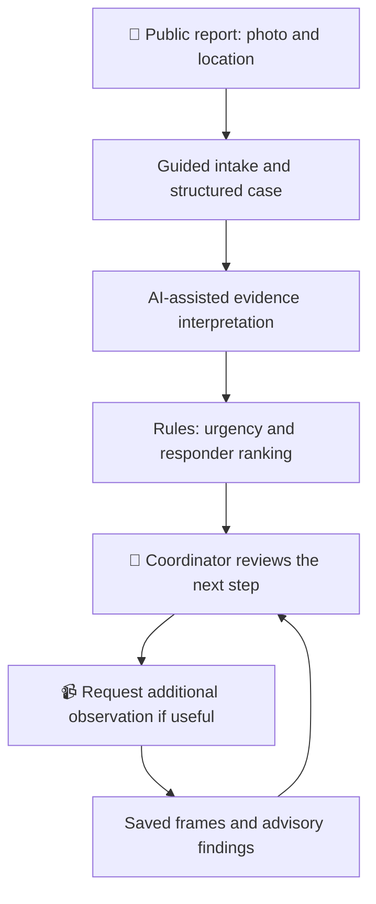

<div align="center">

# 🛟 LifeJacket

### From a wildlife sighting to a clearer rescue decision.

**A human-reviewed rescue coordination prototype**

University of Chicago · MS in Applied Data Science Capstone · 2026

[Start here](#start-here) · [How it works](#how-it-works) · [What is built](#what-is-built) · [Evidence](#evidence-and-evaluation) · [Try the demo](#try-the-demo)

</div>

## Start here

**Imagine finding a seal on a beach. Is it resting, injured, or in immediate danger—and who should receive the report?**

LifeJacket helps a member of the public describe what they see, turns that information into a structured case, and gives a coordinator the evidence and suggested priorities needed to review the next step. Drone observations can add another view when the original report is unclear.

| 📱 Report | 🧭 Review | 📹 Observe |
|---|---|---|
| Photo, location and guided questions | Case summary, urgency reasons and responder candidates | Additional footage, selected photos and advisory findings |
| A person reports what they can safely see | A coordinator reviews the evidence | An operator collects evidence; a coordinator interprets it |

**For judges:** read the workflow below, inspect the screenshot, then review the evidence table. Installation is optional. This repository contains prototype code, evaluation records and reproducible demonstrations—not a deployed emergency service.

## How it works



The observation loop above is the **existing-case workflow**. Automatic patrol-to-case creation remains future work.

### A case, in plain language

1. **Report:** someone uploads a photo and location, selects the intended animal, and answers bounded follow-up questions.
2. **Interpret:** model components help identify the animal, describe visible condition and produce a checked summary. Missing information stays explicit.
3. **Prioritize:** deterministic rules calculate suggested urgency and rank responder candidates. A model does not independently dispatch a crew.
4. **Review:** the coordinator inspects the evidence and records the next step. If another view would help, they can approve an observation request.
5. **Follow up:** saved drone frames and advisory assessments are linked to that same case for comparison and human review.

### The coordinator's view


*Existing UI fixture with fictional cases and a fictional agency reviewer. It is not a real incident, organizational endorsement or screenshot of the newer drone workspace.*

## What is built

| Area | Implemented in the prototype | Boundary |
|---|---|---|
| 📱 Public reporting | Photo-based intake, animal selection, guided questions and structured reports | Identification and condition findings can be wrong; human review matters |
| 🧭 Coordination | Case views, rule-based triage, responder ranking, role-scoped sharing and recorded response updates | No automatic rescue dispatch or verified field operations |
| 📹 Drone evidence | Private stream receiver, sampled live preview, received-video recording/playback, saved frames and a unified observation workspace | Mini 2/iPhone connectivity and visual browser acceptance still need testing |
| 🔎 Detector handoff | Export original frames/metadata; validate and import detector results; select an animal for existing assessment and triage | Trained YOLO execution and automatic live frame shortlisting are not connected yet |
| ✈️ Flight planning | Survey-route generation and ArduPilot software-in-the-loop testing | Simulation is separate from physical Mini 2 control; autonomous Mini 2 flight is not implemented |

**Latest drone workflow:** received video → saved original frame → validated detector results → selected-animal assessment → triage suggestion → coordinator review. Only selected still images are sent for model assessment; original received recordings remain available for review.

[Drone workflow and teammate handoff](docs/drone_detector_handoff.md) · [Recording and playback setup](docs/drone_recordings.md)

## Where AI fits—and where it does not

LifeJacket combines an **orchestrated AI pipeline** with a **bounded, tool-using coordination agent**. These are different roles; the diagram's boxes are not all autonomous agents.

| Component | Responsibility |
|---|---|
| Specialized model components | Detection, identification, condition assessment, cross-checking, report writing and guardrail checks inside a code-managed workflow |
| Coordination agent | Chooses among scoped, read-only tools to inspect case history, assignments, pending tasks and available responders; operates within a bounded loop |
| Python rules and services | Urgency scoring, duplicate checks, responder ranking, permissions, persistence and workflow transitions |
| Human coordinator | Reviews evidence, approves operational next steps and records the outcome |

The code uses names such as `IdentificationAgent`; those class names do not mean that every model call independently plans or acts. No additional autonomous drone agent is required for video ingestion or frame processing.

[Read the backend walkthrough](docs/backend_tour.md) · [Inspect the coordination agent](backend/lifejacket/agents/coordination.py) · [Inspect triage rules](backend/lifejacket/dispatch/severity.py)

## Evidence and evaluation

We distinguish **model quality**, **software integration** and **flight simulation**. A passing software test is not evidence of successful wildlife rescue.

| Evidence | Result | What it establishes—and what it does not |
|---|---|---|
| Saved first-look identification evaluation | **98/102** animal groups correct; **71/102** species correct | Exploratory comparison with source labels on original public photos. Not aerial detection, injury accuracy or calibrated confidence |
| Recorded NOAA sea-lion footage pilot | **12 frames processed, 0 failures** | Processing path ran with real footage and Vertex inference. Candidate boxes were not expert-validated individual animals |
| ArduPilot simulation | **1.18 m** maximum route deviation across **280** telemetry samples | A documented simulated survey completed and landed. Not a physical drone flight |
| Latest focused drone checks, November 11 | **57 backend**, **17 client API**, **3 interface tests** passed | Integration, permissions, provenance and review behavior using synthetic evidence/scripted model responses. Not a full-suite total or live-model accuracy result |

**Inspect the evidence:** [identification outputs](research/identification_eval/results/first_look_20261005_172608_detail.csv) · [real-photo limitations](docs/real_drone_validation_2026-11-07.md) · [NOAA video pilot](docs/noaa_video_pilot.md) · [simulation record](docs/sitl.md#flight-test-findings) · [drone acceptance workflow](docs/drone_detector_handoff.md#software-rehearsal-results)

### What we have not demonstrated

- Improved rescue response times or animal survival.
- Expert-validated injury assessment from aerial footage.
- A working Mini 2 → iPhone → LifeJacket field connection or autonomous Mini 2 flight.
- Trained YOLO execution, automatic live shortlisting or patrol alert creation.
- Production readiness, verified operating permissions or a partner rescue-center field trial.

Demo cases are fictional. Prototype thresholds require domain review. An animal not detected in a frame is **not** confirmed absent or healthy.

## Try the demo

### A first look, without cloud credentials

With **Git** and **Node.js 24.3+**, clone this repository and run from its root:

```bash
npm ci
npm run setup:demos
npm run demo:network
```

Open **<http://127.0.0.1:8082>** on that computer.

- **Reporter fixture:** walk through a fictional report and its status screens.
- **Console fixture:** inspect fictional cases and compare permitted role views.

These are **two independent UI fixtures**, not a connected live rescue. They do not call Gemini, send SMS, share case state or require a database. Reloading resets their fixture state. Initial dependency installation needs internet access.

### Reproduce the connected workflow

The connected scenario uses real API routes with disposable data and scripted adapters:

```bash
python scripts/run_connected_scenario.py --with-drone
```

This requires the backend/development dependencies. For generated-video streaming, recording and saved-frame review, follow the separate [live observation rehearsal](docs/drone_live_workflow.md#connected-browser-rehearsal); it also requires MediaMTX and FFmpeg. Hardware is not needed for that software rehearsal.

<details>
<summary><strong>Developer setup and deeper technical documentation</strong></summary>

Install Python 3.11+ and use an isolated environment:

```bash
python -m venv .venv
# Activate .venv using the command for your operating system.
python -m pip install -r backend/requirements.txt pytest ruff
python -m pytest
```

Live Gemini calls additionally require the project's configured Vertex AI access and Application Default Credentials. Do not commit credentials or publish a development API containing private case data.

| Topic | Entry point |
|---|---|
| Client setup and demo boundaries | [Teammate setup](docs/teammate_setup.md), [client README](clients/README.md) |
| Connected reporter-to-coordinator scenario | [Scenario guide](docs/connected_scenario.md) |
| Intake implementation | [Pipeline](backend/lifejacket/services/pipeline.py) |
| Case access and roles | [Network case access](docs/network_case_access.md) |
| Drone recording, review and deployment | [Recording guide](docs/drone_recordings.md) |
| Detector interface and acceptance | [Handoff guide](docs/drone_detector_handoff.md) |
| Survey planning and simulation | [SITL guide](docs/sitl.md) |

**Core stack:** Expo/React Native/TypeScript clients; Python/FastAPI backend; Gemini via Vertex AI; SQLAlchemy/SQLite; Firebase Authentication; MapLibre; FFmpeg/MediaMTX; ArduPilot SITL. Context integrations include NOAA CO-OPS, Open-Meteo, Nominatim and OpenRouteService; availability is not guaranteed for every case.

</details>

---

**Our aim:** give coordinators clearer evidence and a shared case history, so they can make better-informed decisions. Field impact remains to be measured.
