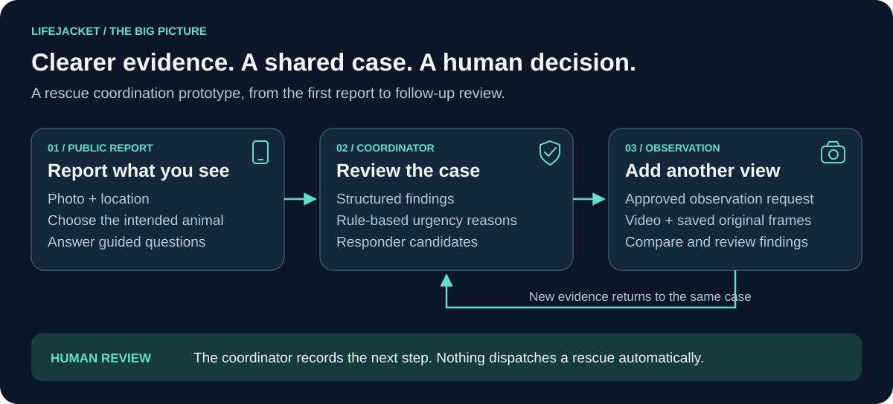
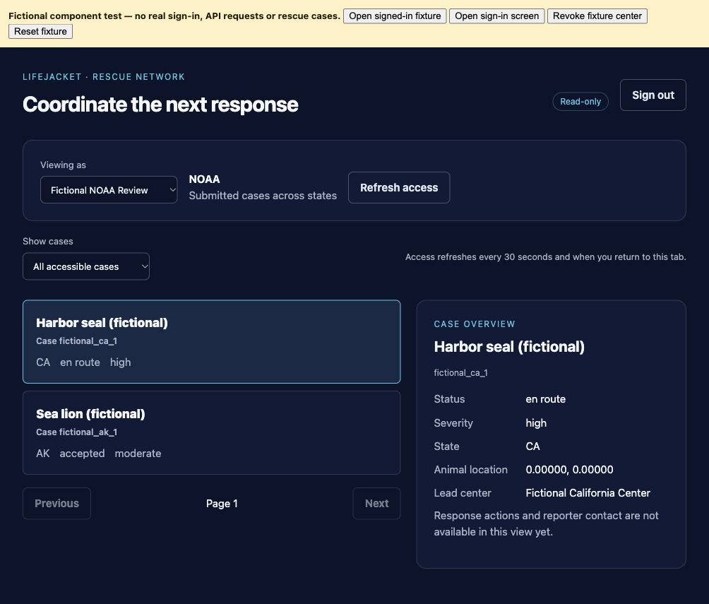
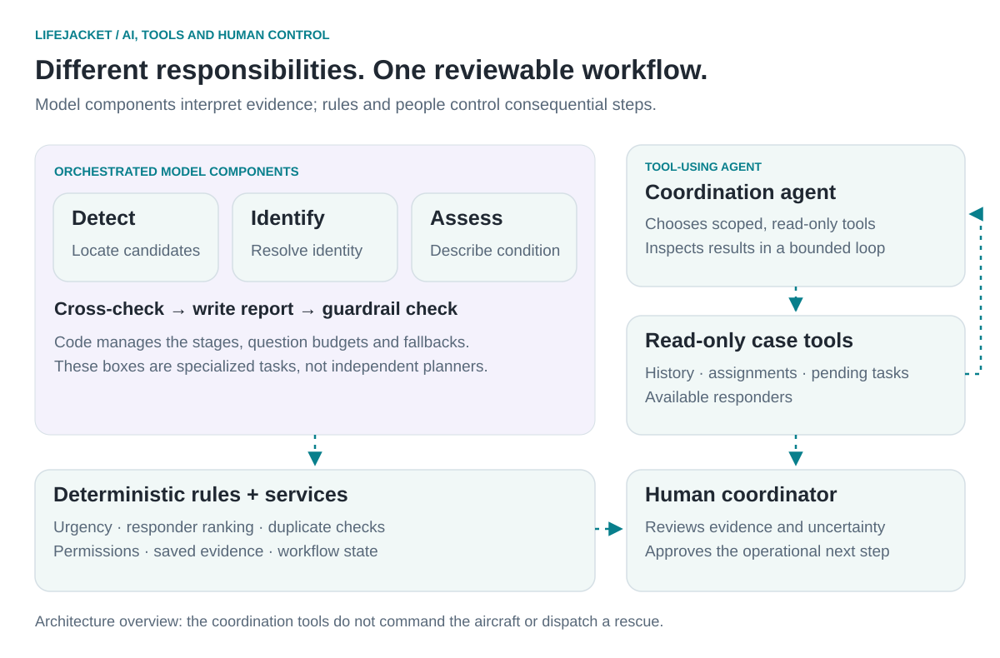
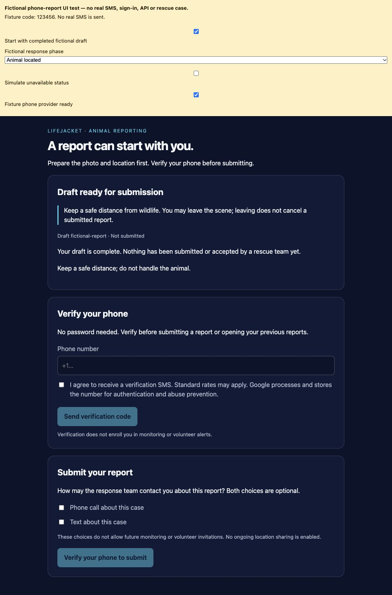
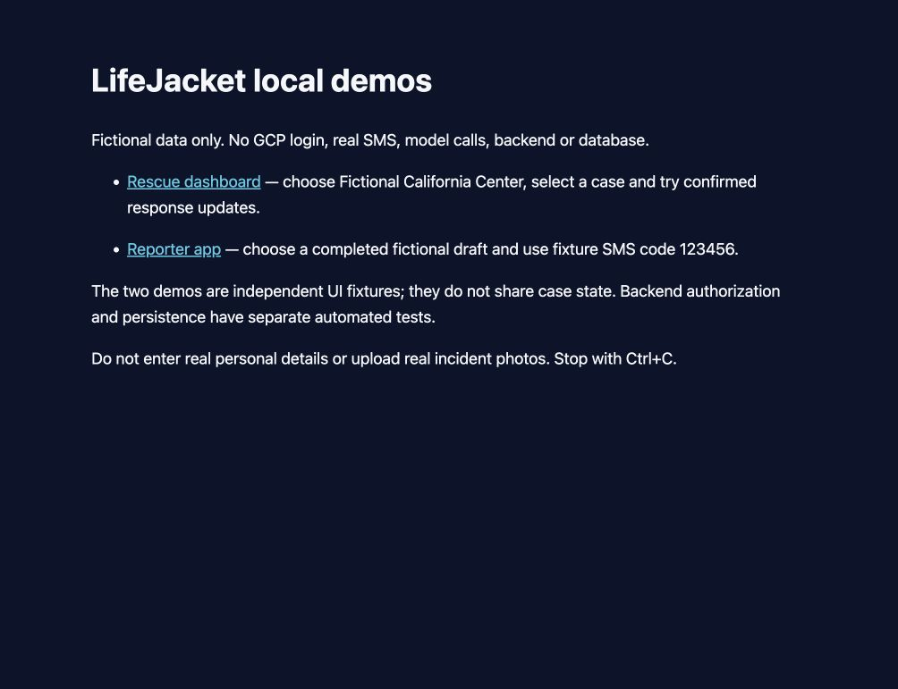

<div align="center">

# 🛟 LifeJacket

## Help a wildlife sighting become an informed rescue decision.

Photo reports, structured triage and drone evidence—brought together for **human-reviewed marine mammal rescue coordination**.

University of Chicago · MS in Applied Data Science Capstone · 2026

[](#how-it-works) &nbsp; [](#try-the-demo) &nbsp; [](#evidence-and-evaluation)

**Research prototype** &nbsp; · &nbsp; **Human approval** &nbsp; · &nbsp; **Selected-frame AI assessment**

[What is built](#what-is-built) · [AI responsibilities](#where-ai-fitsand-where-it-does-not) · [Setup and demo](#try-the-demo)

</div>

---

## Start here

**Imagine finding a seal on a beach. Is it resting, injured, or in immediate danger—and who should receive the report?**

LifeJacket helps a member of the public describe what they see, turns that information into a structured case, and gives a coordinator the evidence and suggested priorities needed to review the next step. Drone observations can add another view when the original report is unclear.

**For judges:** read the workflow below, inspect the screenshot, then review the evidence table. Installation is optional. This repository contains prototype code, evaluation records and reproducible demonstrations—not a deployed emergency service.

[Detailed project walkthrough](#detailed-project-walkthrough) — motivation, intake, coordination, drone lifecycle and simulation background.

## How it works



The observation loop above is the **existing-case workflow**. Automatic patrol-to-case creation remains future work.

### A case, in plain language

1. **Report:** someone uploads a photo and location, selects the intended animal, and answers bounded follow-up questions.
2. **Interpret:** model components help identify the animal, describe visible condition and produce a checked summary. Missing information stays explicit.
3. **Prioritize:** deterministic rules calculate suggested urgency and rank responder candidates. A model does not independently dispatch a crew.
4. **Review:** the coordinator inspects the evidence and records the next step. If another view would help, they can approve an observation request.
5. **Follow up:** saved drone frames and advisory assessments are linked to that same case for comparison and human review.

### The coordinator's view



*Existing UI fixture with fictional cases and a fictional agency reviewer. It is not a real incident, organizational endorsement or screenshot of the newer drone workspace.*

## What is built

| Area | Implemented in the prototype | Boundary |
|---|---|---|
| 📱 Public reporting | Photo-based intake, animal selection, guided questions and structured reports | Identification and condition findings can be wrong; human review matters |
| 🧭 Coordination | Case views, rule-based triage, responder ranking, role-scoped sharing and recorded response updates | No automatic rescue dispatch or verified field operations |
| 📹 Drone evidence | Private stream receiver, Litchi and DJI Fly setup instructions, sampled preview, recording/playback and saved frames on the case | Both apps streamed Mini 2 video to LifeJacket over private Wi-Fi with the motors off |
| 🔎 Detector handoff | Export original frames/metadata; validate and import detector results; select an animal for existing assessment and triage | Trained YOLO execution and automatic live frame shortlisting are not connected yet |
| ✈️ Flight planning | Editable case search area, patrol preview, draft waypoint export to Litchi and ArduPilot upload/readback | The exported route loaded on the pilot's iPhone. Outdoor waypoint flight with live video remains untested |

### The drone evidence loop


**Latest drone workflow:** received video → saved original frame → validated detector results → selected-animal assessment → triage suggestion → coordinator review. Only selected still images are sent for model assessment; original received recordings remain available for review.

[Mini 2 ground-test results and setup](docs/drone_live_workflow.md#ground-test-results-on-2026-11-24) · [Detector handoff](docs/drone_detector_handoff.md) · [Recording and playback setup](docs/drone_recordings.md)

## Where AI fits—and where it does not

LifeJacket combines an **orchestrated AI pipeline** with a **bounded, tool-using coordination agent**. These are different roles; the diagram's boxes are not all autonomous agents.



| Component | Responsibility |
|---|---|
| Specialized model components | Detection, identification, condition assessment, cross-checking, report writing and guardrail checks inside a code-managed workflow |
| Coordination agent | Chooses among scoped, read-only tools to inspect case history, assignments, pending tasks and available responders; operates within a bounded loop |
| Python rules and services | Urgency scoring, duplicate checks, responder ranking, permissions, persistence and workflow transitions |
| Human coordinator | Reviews evidence, approves operational next steps and records the outcome |

The code uses names such as `IdentificationAgent`; those class names do not mean that every model call independently plans or acts. No additional autonomous drone agent is required for video ingestion or frame processing.

[Read the backend walkthrough](docs/backend_tour.md) · [Inspect the coordination agent](backend/lifejacket/agents/coordination.py) · [Inspect triage rules](backend/lifejacket/dispatch/severity.py)

## Evidence and evaluation

The results cover model evaluation, software integration, flight simulation and motors-off hardware checks.

| Evidence | Result | What it establishes—and what it does not |
|---|---|---|
| Saved first-look identification evaluation | **98/102** animal groups correct; **71/102** species correct | Exploratory comparison with source labels on original public photos. Not aerial detection, injury accuracy or calibrated confidence |
| Recorded NOAA sea-lion footage pilot | **12 frames processed, 0 failures** | Processing path ran with real footage and Vertex inference. Candidate boxes were not expert-validated individual animals |
| ArduPilot simulation | **1.18 m** maximum route deviation across **280** telemetry samples | A documented simulated survey completed and landed. Not a physical drone flight |
| Case patrol simulator handoff | **16 mission items** uploaded and read back through both the coordinator API and browser demo | ArduPilot verified the planned commands, coordinates and altitudes with the simulator disarmed |
| Mini 2 ground checks, November 24 | **12 draft waypoints** loaded on the iPhone. DJI Fly and Litchi each streamed the camera to LifeJacket | Waypoint sync and private RTMP worked in separate motors-off checks. The outdoor combined test is pending |

**Inspect the evidence:** [identification outputs](research/identification_eval/results/first_look_20261005_172608_detail.csv) · [real-photo limitations](docs/real_drone_validation_2026-11-07.md) · [NOAA video pilot](docs/noaa_video_pilot.md) · [simulation record](docs/sitl.md#flight-test-findings) · [drone acceptance workflow](docs/drone_detector_handoff.md#software-rehearsal-results)

### What we have not demonstrated

- Improved rescue response times or animal survival.
- Expert-validated injury assessment from aerial footage.
- Outdoor Mini 2 waypoint flight with simultaneous streaming to LifeJacket.
- Trained YOLO execution, automatic live shortlisting or patrol alert creation.
- Production readiness, verified operating permissions or a partner rescue-center field trial.

Demo cases are fictional. Prototype thresholds require domain review. An animal not detected in a frame is **not** confirmed absent or healthy.

## Try the demo

### A first look, without cloud credentials

With **Git** and **Node.js 24.3+**, clone this repository and run from its root:

```bash
npm ci
npm run setup:demos
npm run demo:network
```

Open **<http://127.0.0.1:8082>** on that computer.

- **Reporter fixture:** try the phone-friendly chat, choose an animal in a sample
  photo, share a map pin, answer follow-up questions, and check your report status.
- **Console fixture:** inspect fictional cases and compare permitted role views.

These are **two independent UI fixtures**, not a connected live rescue. They do not call Gemini, send SMS, share case state or require a database. Reloading resets their fixture state. Initial dependency installation needs internet access.

### Try the case-linked drone demo

With the Node dependencies above and the [Python backend dependencies](#developer-setup) installed, run:

```bash
npm run demo:drone-requests
```

Open **<http://127.0.0.1:8084>**, select **Bear report · approximate location**,
review the suggested request and create it. Choose **Preview patrol** to see
the proposed pass. **Run simulated patrol** replays the route on the map.
Under **Mission handoff**, download a draft for Litchi or use **Send to
simulator** to verify an upload when [local ArduPilot is configured](docs/sitl.md#send-a-case-patrol-to-the-simulator).

### Reproduce the connected workflow

The connected scenario uses real API routes with disposable data and scripted adapters:

```bash
python scripts/run_connected_scenario.py --with-drone
```

This requires the backend/development dependencies. For generated-video streaming, recording and saved-frame review, follow the separate [live observation rehearsal](docs/drone_live_workflow.md#connected-browser-rehearsal); it also requires MediaMTX and FFmpeg. Hardware is not needed for that software rehearsal.

### Developer setup

<details>
<summary><strong>Python dependencies and technical references</strong></summary>

Install Python 3.11+ and use an isolated environment:

```bash
python -m venv .venv
# Activate .venv using the command for your operating system.
python -m pip install -r backend/requirements.txt pytest ruff
python -m pytest
```

Live Gemini calls additionally require the project's configured Vertex AI access and Application Default Credentials. Do not commit credentials or publish a development API containing private case data.

| Topic | Entry point |
|---|---|
| Client setup and demo boundaries | [Teammate setup](docs/teammate_setup.md), [client README](clients/README.md) |
| Connected reporter-to-coordinator scenario | [Scenario guide](docs/connected_scenario.md) |
| Intake implementation | [Pipeline](backend/lifejacket/services/pipeline.py) |
| Case access and roles | [Network case access](docs/network_case_access.md) |
| Drone recording, review and deployment | [Recording guide](docs/drone_recordings.md) |
| Detector interface and acceptance | [Handoff guide](docs/drone_detector_handoff.md) |
| Survey planning and simulation | [SITL guide](docs/sitl.md) |

**Core stack:** Expo/React Native/TypeScript clients; Python/FastAPI backend; Gemini via Vertex AI; SQLAlchemy/SQLite; Firebase Authentication; MapLibre; FFmpeg/MediaMTX; ArduPilot SITL. Context integrations include NOAA CO-OPS, Open-Meteo, Nominatim and OpenRouteService; availability is not guaranteed for every case.

</details>

---

**Our aim:** give coordinators clearer evidence and a shared case history, so they can make better-informed decisions. Field impact remains to be measured.

## Detailed project walkthrough

<details>
<summary>Expand the detailed walkthrough retained from main</summary>

The overview above records the current integration boundaries. This walkthrough retains the project background and deeper implementation notes from main.

<div align="center">

# LifeJacket

### *Integrating AI-Powered Rescue Coordination and Drone Surveillance for Wildlife Protection*

MS in Applied Data Science Capstone · University of Chicago · 2026

</div>

---

## Table of Contents

1. [🌊 Project Motivation](#1--project-motivation)
2. [🦭 Overview of LifeJacket](#2--overview-of-lifejacket)
3. [🧭 The Project](#3--the-project)
   - [3.1 Public App — a guided report from the person who found the animal](#31-public-app--a-guided-report-from-the-person-who-found-the-animal)
     - [3.1.1 Behind the app: seven stages from photo to report](#311-behind-the-app-seven-stages-from-photo-to-report)
   - [3.2 Rescue Console — where rules score urgency and coordinators decide](#32-rescue-console--where-rules-score-urgency-and-coordinators-decide)
     - [3.2.1 Models perceive, code decides](#321-models-perceive-code-decides)
     - [3.2.2 One case, shared across centers and agencies](#322-one-case-shared-across-centers-and-agencies)
   - [3.3 Drones — a look at places crews can't reach](#33-drones--a-look-at-places-crews-cant-reach)
   - [3.4 Architecture](#34-architecture)
4. [📊 Evaluation and Results](#4--evaluation-and-results)
5. [🌍 Why It Matters Beyond the Animals](#5--why-it-matters-beyond-the-animals)
6. [🚀 Future Work](#6--future-work)
7. [🛠️ Tools Used](#7-️-tools-used)
8. [⚡ Getting Started](#8--getting-started)

---

## 1. 🌊 Project Motivation

*Human activity is driving wildlife toward extinction — and when an injured animal is found, the first few minutes decide what happens next.*

<div align="center">

| | | |
|:---:|:---:|:---:|
| **650,000+** | **49,505** | **1 million** |
| marine mammals killed or seriously injured in fishing gear every year | species threatened with extinction | species could face extinction, many within decades, unless action is taken |
| *Marine Mammal Commission* | *IUCN Red List, July 2026* | *IPBES Global Assessment* |

</div>

<div align="center">


</div>

<!-- PLACEHOLDER: entangled monk seal — NOAA Fisheries (Permit #10137), public domain -->
<!-- PLACEHOLDER: oiled brown pelicans, Grand Isle LA, 2010 — Int'l Bird Rescue Research Center, CC BY 2.0 (credit required) -->

### Where the current system breaks down

Today a rescue begins with a phone call which starts a chain of events filled with inefficiencies and information + time loss.

**The public doesn't know how to help.** Someone has to find the animal, figure out who to call, and work out how and what to report — usually about a species they can't name and know little about.

**Rescuers triage over the phone.** Coordinators must extract species, condition, location and urgency from a stranger in a few minutes, then dispatch on incomplete information.

**Resources are stretched thin.** Teams are small, and **94% of wildlife rehabilitation programs rely on volunteers** (IWRC, 2026). The whole system is reactive: help waits for a call, and animals in places people don't visit go unseen.

---

## 2. 🦭 Overview of LifeJacket

*LifeJacket looks save animals by improving the efficiency of the current wildlife rescue system. By introducing an AI-powered tools, LifeJacket can increase the quality of care for injured animals.*

<div align="center">

</div>

<!-- PLACEHOLDER: system overview diagram — adapt slide 5 of LifeJacket_Draft_20261109.pptx -->

**1. The Public App** — An AI chatbot assesses the incident quickly, gives the reporter guidance on what to do in the meantime, and routes the report to the right organization automatically.

**2. The Rescue Console** — Coordinators analyze rather than extract. Every report arrives with weather, tide, daylight, exact location and directions already attached. Humans override anything the AI got wrong, and nothing is dispatched without approval.

**3. Drones** — A quick aerial look at incidents that may not need a crew, so scarce staff go only where they're needed.

> Together, these turn a scattered phone-and-notepad process into one structured case that any coordinator on duty can pick up.

---

## 3. 🧭 The Project

### 3.1 Public App — a guided report from the person who found the animal

<div align="center">
<video src="docs/images/reporter-walkthrough.mp4" width="350" controls></video>
</div>

<!-- PLACEHOLDER: screen recording of the reporter flow, portrait, ~30-45s -->

| | What the reporter does |
|:---:|---|
| **1** | **Photo + map pin.** A photo and an exact location replace the hardest part of the phone call — describing the animal and the place |
| **2** | **Tap the animal you mean.** If several animals are in frame, detection AI outlines each one and the reporter picks the one in trouble |
| **3** | **A few tap-to-choose questions.** The AI asks only what the photo can't show — at most five to identify the species, five to assess condition |
| **4** | **Safety guidance and a trackable case.** Keep your distance, don't handle the animal, and follow the case reference through every status update |

```
Received  →  Accepted  →  En route  →  On scene  →  Animal located  →  Closed
```

<div align="center">

</div>

*Reporter app UI fixture with a completed fictional draft — no real report, SMS or rescue case.*

> ⚠️ **Honest limit:** the urgency score applies to the animal the reporter selects. If someone taps the healthy seal in a photo that also contains an injured one, the case is scored on the healthy one.

#### 3.1.1 Behind the app: seven stages from photo to report

```
     REPORTER'S PHONE                                  RESCUE CONSOLE
      photo + location                                  report + map
            │                                                 ▲
            ▼                                                 │
  ┌─────────────────────────────────────────────────────────────────┐
  │  1  CONTEXT     tide, weather, daylight, place name   [external] │
  │  2  IDENTIFY    species, up to 5 questions per photo  [AI model] │
  │  3  ASSESS      condition and hazards, up to 5 more   [AI model] │
  │  4  TRIAGE      weighted rules                     ** NO MODEL **│
  │  5  REPORT      the write-up for responders           [AI model] │
  │  6  GUARDRAIL   a second model re-checks it           [AI model] │
  │  7  DISPATCH    rank centers by area + capability  ** NO MODEL **│
  └─────────────────────────────────────────────────────────────────┘
                              │
                              ▼
                      HUMAN APPROVES
```

The two most consequential stages — **triage** and **dispatch** — are the two with no model in them. That is deliberate, and it is the central design decision of the project.

Context comes from NOAA CO-OPS (tides), Open-Meteo (weather, sunrise and sunset) and Nominatim (place names). The tide matters most: the same animal at the same spot is a different emergency on a rising tide than a falling one.

---

### 3.2 Rescue Console — where rules score urgency and coordinators decide

<div align="center">

</div>

<!-- PLACEHOLDER: screenshot of the Triage tab at ~1440x820 -->

| Feature | What it does |
|---|---|
| *Live triage map* | Urgency-colored pins; clicking one opens the incident card with photo, summary and the reasons behind its level |
| *Ranked responder candidates* | Distance, capability match and estimated drive time |
| *Contact the reporter* | Call or text for more details or photos, if they opted in |
| *Shift handover* | What changed during a window, and which cases are still open |

> 🧑‍✈️ **HUMAN IN THE LOOP** — Coordinators can override any AI conclusion they judge wrong, and **nothing is dispatched without their approval**.

#### 3.2.1 Models perceive, code decides

AI extracts the evidence. A deterministic, auditable rule set turns that evidence into an urgency level.

| Level | Score |
|---|---|
| *Guidance* | < 1 |
| *Monitor* | 1 to < 3 |
| *Respond* | 3 to < 6.5 |
| *Critical* | 6.5+ **or** a critical override |

**Critical overrides** — entanglement · bleeding wound · breathing distress · unresponsive · immobile cetacean

Weather contributes at most 0.5 points, and a falling tide can shorten the response window.

> Rules keep urgency **explainable** to a coordinator who disagrees, **reproducible** across identical reports, and **tunable** without retraining anything.

*These weights are a prototype and require expert review. They are not clinically validated policy.*

#### 3.2.2 One case, shared across centers and agencies

Strandings don't respect organizational boundaries, so a newer layer lets several rescue centers and a wildlife agency work the same case with controlled visibility.

<div align="center">

</div>

| Role | Sees |
|---|---|
| *Reporter* | Submits a private case and sees only permitted status updates |
| *Center A* | Leads the case and coordinates the response |
| *Center B* | An accepted rescuer confirms response events |
| *NOAA* | A wildlife agency reads the same case across states |

> ✅ **Tested end to end:** 42 automated checks pass for one case across all four roles, on a disposable database.

*Screenshot is a UI fixture with fictional cases and a fictional reviewer.*

---

### 3.3 Drones — a look at places crews can't reach

*Three jobs: verify a case now, watch it over time, patrol next.*

| | **VERIFY · NOW** | **MONITOR · NOW** | **PATROL · NEXT STEP** |
|---|---|---|---|
| *What it answers* | "Is that sea otter pup stranded, or is its mother nearby?" | "Has anything changed since yesterday?" | "Is anything in trouble on a beach nobody walks?" |
| *What starts it* | Low confidence on a reviewed case, or a coordinator's own judgment | A coordinator schedules the next review | A report-density layer on the console map |
| *Built so far* | Case-linked requests, approval and operator handoff, live and recorded frame capture, human review | Due/overdue queue, continue / escalate / finish decisions, background reminders | A historical density layer from NOAA's California records (2006–2025) |

**Nothing flies on a model's say-so.** A suggestion is a prompt for a coordinator, approval is a human action, and every frame that becomes evidence was chosen by a person.

#### A drone request belongs to a case

Drone work used to sit in its own lab page, disconnected from any real report. It now hangs off a reviewed case in the Rescue network and runs one lifecycle:

```
requested  →  approved  →  in progress  →  evidence ready  →  reviewed
                 │              │                                 │
        lead names an     operator confirms site,         answered /
        operator and      weather, range and battery      still uncertain /
        writes the        before anything can be          escalation needed
        question          collected
```

Decline, cancel and failure paths are all kept. **Completing a flight is not the same as answering the question** — the review step is separate, and a person writes the finding.

Findings are an addendum to the case. The original intake and the rescue response status are never overwritten, and the response never waits on a drone.

<div align="center">

</div>

<!-- PLACEHOLDER: capture from `npm run demo:drone-requests` (loopback :8084, fictional data, no backend) -->

Only the active lead coordinator can change a request; other involved approved staff can read it. Naming an operator records responsibility — it does not grant an account or permission to fly. Every state and evidence change goes through a compare-and-swap revision check and an append-only event log, so two coordinators editing at once cannot silently overwrite each other.

#### When the model isn't sure, it says so — and stops there

The case endpoint now derives a suggestion from confidence values already saved on the case. It makes no model call, issues no aircraft command, and creates no record just by being read.

| Signal | Rule |
|---|---|
| *Animal group uncertain* | Highest probability, pooled across species in the same routing group, falls below the threshold |
| *Condition uncertain* | The saved injury-assessment confidence falls below the threshold |
| *Intake asked for a better photo* | The report explicitly flagged the image as inadequate — at **any** confidence |
| *Species uncertain, group confident* | **No suggestion.** Group is what drives routing, so the exact species can stay open |
| *No usable score* | **No suggestion.** A missing confidence is never invented as a zero |
| *Urgent case* | Review may run **in parallel** — dispatch is never held back for it |

The cutoff is one setting, `DRONE_VERIFICATION_CONFIDENCE_THRESHOLD`, default **0.90** and explicitly provisional.

Acting on a suggestion opens an editable draft. Submitting is a deliberate coordinator action, and the server re-checks the evidence before accepting it. While a request is active, the same evidence will not produce another one; closed, duplicate and unresolved cases produce none at all.

#### From camera to reviewed evidence

Two routes bring footage to a coordinator. Both end in the same place — a person looking at a frame and deciding.

**Live, from the pilot's phone**

The Mini 2 sends video through Litchi or DJI Fly on the iPhone. The operator
publishes over RTMP to a private MediaMTX receiver. LifeJacket displays up to
two frames per second and hides views more than six seconds old.

The publishing address expires after 30 minutes and grants publishing access
only. Incoming images sit in a bounded 12-second buffer. When the coordinator
saves a frame, LifeJacket uses the exact displayed frame ID and stores the
original image and its hash on the case.

> The pilot uses Litchi for the waypoint handoff. LifeJacket generates the route and receives video for review. Actual waypoint flight is still untested.

<div align="center">

</div>

<!-- PLACEHOLDER: capture from `python scripts/drone_stream_demo.py` — real RTMP receiver, disposable database, generated MP4 -->

**From a recorded file**

The existing extract → hash → review path still stands, and a new selector answers the question that makes long footage usable: *which five frames out of twenty minutes are worth a coordinator's time?*

| Layer | What it does | Cost |
|---|---|---|
| *1 · Scan* | Decode at 160×90 and 2 fps. Drop blurred frames (Laplacian sharpness under half the clip's median), bad exposure and near-duplicates (64-bit perceptual hash); mark shot cuts; cap at 40 candidates | Free, local |
| *2 · Describe* | One model call per surviving candidate, which only describes what the frame shows | One call per candidate |
| *3 · Select* | Deterministic pick of up to 5 clear frames that differ in view and side | Free, code |

**The model never picks the frames.** It describes them; the choosing is code — the same split as everywhere else in LifeJacket. Running `select --scan-only` does layer 1 alone and prints the candidate offsets with no model calls and no cost.

**Advisory screening on a saved frame.** A coordinator can explicitly send one saved frame to the same detection → identification → condition agents that run on reporter photos, then select the intended animal and confirm a second time before assessment. The frame's hash is re-checked first, and the result is stored *beside* the case, never over it. An empty detection means "look again yourself", not "nothing is there".

#### Following through when no one is watching

A monitoring request is only worth making if somebody comes back to it. A separate worker scans the database with no coordinator page open, derives overdue reviews and escalations from the existing workflow, and queues one notification per lead organization.

| | |
|---|---|
| *Transport* | Signed HTTPS webhook — HMAC-SHA256 over the exact body, stable idempotency key |
| *Guarantee* | At least once, not exactly once; five attempts with backoff, redirects rejected |
| *Contents* | Identifiers only — no reporter contact, no GPS, no photos, no free text, no publishing address |
| *Cancellation* | Closing or transferring the case, revoking verification, rescheduling, or acknowledging the attention cancels unsent items |

Delivered means the destination accepted the callback, not that a human read it. No destination is configured in this repository and every flag defaults off.

#### What we actually know about the 90% rule

Two offline studies. Both say the same thing: not yet.

| Study | Result | What it is not |
|---|---|---|
| *Policy sweep* | 12 synthetic scenarios across eight cutoffs. 90% finds all 5 expected positives with 0 unexpected suggestions; 95% and above begin over-suggesting | Not calibrated probabilities, not real observations, and with no held-out split it cannot select a cutoff |
| *Real-photo retrospective* | The same 102 public photos as §4, re-scored with the drone policy's group pooling: **95.1%** agreement (97/102; a tied maximum counts as unresolved). At 90%, 100 photos clear the cutoff and **4 of those disagree with the reference group** | Saved outputs re-analyzed, not a fresh run, not expert-adjudicated, and not aerial |

That second row is the useful one. **A confidence threshold does not catch a confident mistake** — the four disagreements all scored 95% or higher, so no low-confidence trigger would ever have flagged them.

On the 38 assessed condition-pilot photos the rule asks for extra evidence on **24 (63%)**. Whether that is a sensible workload is a question for a response partner, not one we can answer ourselves.

#### How a survey is planned

A coordinator drags a box on the map. The planner turns it into a lawnmower route — rows across the box, alternating direction, starting at the southwest corner. Pure geometry, no model.

<div align="center">

</div>

<!-- PLACEHOLDER: screenshot of Drone Lab with a built plan -->

Before anything flies, the plan is validated against hard limits:

| Limit | Value |
|---|---|
| *Altitude band* | 10–100 m |
| *Distance from home* | ≤ 2,000 m |
| *Total route* | ≤ 4,000 m |
| *Simulated wind* | ≤ 8 m/s |
| *Endurance* | 1,200 s with a 25% reserve |
| *Row spacing* | ≤ 50 m |

#### It actually flew — in simulation

<div align="center">

### **1.18 m**
**maximum distance from the planned route, across 280 telemetry samples**

</div>

- ✅ Plan uploaded over MAVLink to **real ArduCopter 4.6.3 autopilot firmware**
- ✅ Flown in software-in-the-loop on GCP, 22 October 2026
- ✅ Completed the survey, returned, landed and disarmed
- ✅ Controlled cancel also landed cleanly; injected link loss was correctly flagged as unconfirmed
- ✅ Normal arming checks throughout — no force-arm, no bypass

<div align="center">

</div>

<!-- PLACEHOLDER: planned route vs flown trace plot -->

#### 🔗 The missing link

| Flight | Perception | Coordination |
|---|---|---|
| ✅ Planned route flown in simulation within **1.18 m** | ✅ Recorded video and live RTMP both reach a human reviewer | ✅ Request, approval, evidence and review run end to end on one case |
| ❌ No physical aircraft has flown | ❌ Aerial recognition accuracy is unmeasured | ❌ Never run against real operational data |

**The Mini 2 passed two motors-off ground checks on November 24, 2026.** The fictional LifeJacket patrol imported into Litchi Legacy Mission Hub and loaded on the pilot's iPhone. In a separate ground check, Litchi streamed the Mini 2 camera to LifeJacket over private Wi-Fi. DJI Fly also streamed to the same receiver and was used to verify frame saving and reconnect behavior.

The outdoor test will check whether Litchi can fly a short route planned for the site while LifeJacket continues receiving fresh frames. Camera-to-screen delay and the usefulness of aerial wildlife footage still need measurement. [Ground-test record and handoff](docs/drone_live_workflow.md#ground-test-results-on-2026-11-24).

---

### 3.4 Architecture

<div align="center">

</div>

<!-- PLACEHOLDER: architecture diagram -->

```
clients/reporter_app/        Expo + TypeScript — the public's phone app
clients/responder_console/   Expo + web — the rescue organization's console
clients/shared/              one API client and one design system

backend/lifejacket/
  agents/        six intake agents, a frame observer, a bounded coordination agent
  dispatch/      severity, duplicates, mass strandings, responder matching (no LLM)
  context/       NOAA CO-OPS tides, Open-Meteo weather, Nominatim, OpenRouteService
  access/        role-scoped permissions across centers and agencies
  drones/        planner, SITL adapter, recorded-video pipeline, frame selection
  services/      the intake pipeline — the single best entry point to the code
  models/        30 tables, Pydantic schemas
  api/routes/    15 route groups, 84 endpoints

prompts/         prompts as Markdown, not Python strings
config/          every tunable number, with a comment on where it came from
```

---

## 4. 📊 Evaluation and Results

<a id="evaluation"></a>

### Species identification

102 curated public photos, one initial pass, no follow-up answers.

<div align="center">

| **96%** | **70%** |
|:---:|:---:|
| animal group correct | species correct |
| *98 / 102* | *71 / 102* |

</div>

Animal group is what drives responder matching, so the higher figure is the one that affects routing. Gemini 2.5 Flash, temperature 0.1.

*Exploratory evaluation. Not aerial-detector accuracy, not injury accuracy, and not a calibrated confidence result.*

### Engineering validation

| Result | Detail |
|---|---|
| *Automated tests* | **755**, all running offline against a deterministic stand-in model — no API key, no network, no cost |
| *Simulated flight* | **1.18 m** max deviation across 280 samples on real autopilot firmware |
| *Video pipeline* | **12 frames, 0 failures** on real NOAA footage |
| *Live stream transport* | Real RTMP publish → receive → save-frame → interrupt → reconnect, with MediaMTX and a generated video |
| *Case-linked drone flow* | One case driven through request, approval, evidence and review against the real endpoints |
| *Multi-organization case* | **42 checks** pass for one case across four roles |

### What we have not shown

This matters as much as what we have:

- ❌ **Response-time or survival improvements** — not measured
- ❌ **Injury assessment from the air** — not validated
- ❌ **A calibrated battery model** — an approved simulated flight ran low on reserve in modest wind
- ❌ **A physical flight** — all flight to date is simulated
- ❌ **Real incident data** — the demo database is seeded sample data

> LifeJacket is **not a dispatch system**. No permits are verified and no one is tasked automatically.

---

## 5. 🌍 Why It Matters Beyond the Animals

*Healthy wildlife, healthy ecosystems and healthy people are one system.*

<div align="center">

| **6 in 10** | **3 in 4** |
|:---:|:---:|
| known infectious diseases in people can spread from animals | new or emerging infectious diseases in people come from animals |

*CDC, One Health*

</div>

**Sick wildlife is an early warning system.** California sea lions are among the first animals hit by toxic algae, and eat many of the same kinds of seafood people do — their outbreak data help officials decide when to issue seafood warnings.

**Safer encounters with wild animals.** More than 90% of reported animal rabies cases in the U.S. are in wildlife. The app tells people to keep their distance and not handle the animal.

**Located, structured reports.** Every report carries a photo, coordinates and a condition record, and a deterministic check flags possible mass strandings.

*Earlier warning for public health agencies is an intended benefit, not one we have measured.*

---

## 6. 🚀 Future Work

**From reactive to proactive**

```
TODAY     animal is hurt → someone happens to notice → they find a hotline → a team responds
NEXT      past reports show hotspots → drones patrol → animal spotted early → coordinator opens a case
```

Already built: a historical report-density layer from NOAA's California records (2006–2025) on the console map. *Density reflects where people reported strandings, not risk, so it needs expert validation before it guides patrols.*

**Open work**

- **Verify outdoor waypoint flight and streaming together** with the Mini 2 and Litchi, and measure camera-to-screen delay
- **Calibrate the battery model** against real flight data
- **Calibrate the 0.90 suggestion threshold** on reviewer-labeled cases with a genuine held-out split
- **Validate identification** against expert-labeled stranding cases
- **Widen the region** beyond the California pilot bounds
- **Add volunteer matching** — responder ranking currently covers organizations only
- **Field trial** with a partner rescue center

---

## 7. 🛠️ Tools Used

| Layer | Stack |
|---|---|
| *Backend* | Python 3.11+ · FastAPI · SQLAlchemy · SQLite · Pydantic v2 |
| *AI* | Gemini 2.5 Flash via Vertex AI (`google-genai`) — Application Default Credentials only |
| *Clients* | Expo SDK 57 · React Native 0.86 · React 19 · TypeScript |
| *Maps* | MapLibre GL JS (web) · react-native-maps (native) |
| *External data* | NOAA CO-OPS · Open-Meteo · Nominatim · OpenRouteService |
| *Drone* | ArduPilot SITL 4.6.3 · MAVLink · pymavlink · FFmpeg · MediaMTX (RTMP) · Pillow |
| *Identity* | Firebase Authentication |
| *Testing* | pytest (755 offline tests) · ruff |

---

## 8. ⚡ Getting Started

```bash
# Backend
make setup                      # venv + dependencies
make run                        # API on http://localhost:8000
make test                       # 755 tests, fully offline

# Rescue console (web)
cd clients/responder_console && npx expo start --web --port 19006

# Reporter app
cd clients/reporter_app && npx expo start --web --port 19007
```

**No credentials needed for a first look.** From the repository root:

```bash
npm ci && npm run setup:demos && npm run demo:network
```

Open <http://127.0.0.1:8082> — two labeled UI fixtures with fictional data. No GCP login, no SMS, no model calls, no database.

**Walk one case through the drone flow**, from a low-confidence report to a reviewed frame:

```bash
python scripts/run_connected_scenario.py --with-drone
```

It runs the real request, approval, evidence and review endpoints against a temporary database and a generated frame, then writes an HTML trace to `var/connected-drone-workflow/`. No server, no model calls, no aircraft. See [`docs/connected_drone_scenario.md`](docs/connected_drone_scenario.md).

<div align="center">

</div>

See [`docs/teammate_setup.md`](docs/teammate_setup.md) for the full setup, and [`clients/README.md`](clients/README.md) for the two apps.

---

<div align="center">

</div>

</details>
