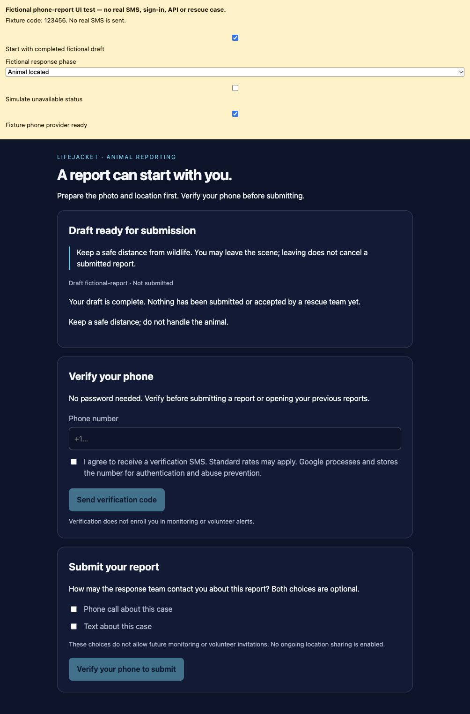
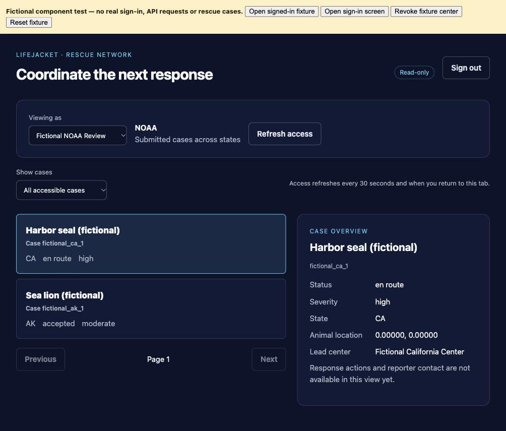
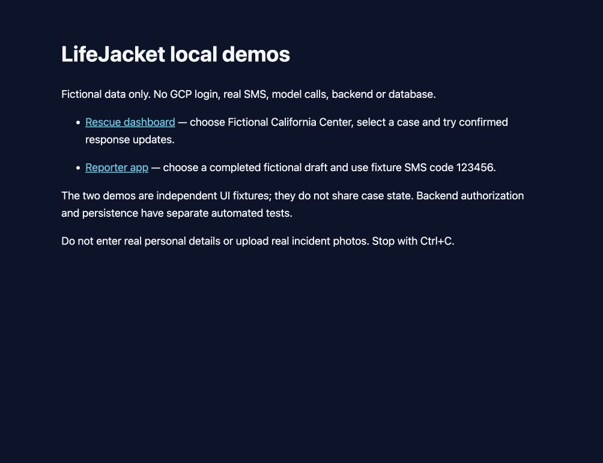

<div align="center">

# LifeJacket

### *From a wildlife sighting to a reviewed response*

**Models perceive. Code decides. Humans approve.**

MS in Applied Data Science Capstone · University of Chicago · 2026

</div>

---

## Table of Contents

1. [🌊 Project Motivation](#1--project-motivation)
2. [🦭 Overview of LifeJacket](#2--overview-of-lifejacket)
3. [🧭 The Project](#3--the-project)
   - [3.1 Public App — a guided report from the person who found the animal](#31-public-app--a-guided-report-from-the-person-who-found-the-animal)
     - [3.1.1 Behind the app: seven stages from photo to report](#311-behind-the-app-seven-stages-from-photo-to-report)
   - [3.2 Rescue Console — where rules score urgency and coordinators decide](#32-rescue-console--where-rules-score-urgency-and-coordinators-decide)
     - [3.2.1 Models perceive, code decides](#321-models-perceive-code-decides)
     - [3.2.2 One case, shared across centers and agencies](#322-one-case-shared-across-centers-and-agencies)
   - [3.3 Drones — a look at places crews can't reach](#33-drones--a-look-at-places-crews-cant-reach)
   - [3.4 Architecture](#34-architecture)
4. [📊 Evaluation and Results](#4--evaluation-and-results)
5. [🌍 Why It Matters Beyond the Animals](#5--why-it-matters-beyond-the-animals)
6. [🚀 Future Work](#6--future-work)
7. [🛠️ Tools Used](#7-️-tools-used)
8. [⚡ Getting Started](#8--getting-started)

---

## 1. 🌊 Project Motivation

*Human activity is driving wildlife toward extinction — and when an injured animal is found, the first few minutes decide what happens next.*

<div align="center">

| | | |
|:---:|:---:|:---:|
| **650,000+** | **49,505** | **1 million** |
| marine mammals killed or seriously injured in fishing gear every year | species threatened with extinction, 28% of all assessed so far | species could face extinction, many within decades, unless action is taken |
| *Marine Mammal Commission* | *IUCN Red List, July 2026* | *IPBES Global Assessment* |

</div>

<div align="center">


</div>

<!-- PLACEHOLDER: entangled monk seal — NOAA Fisheries (Permit #10137), public domain -->
<!-- PLACEHOLDER: oiled brown pelicans, Grand Isle LA, 2010 — Int'l Bird Rescue Research Center, CC BY 2.0 (credit required) -->

### Where the current system breaks down

Today a rescue begins with a phone call, and that call fails three groups at once.

**The public doesn't know how to help.** Someone has to find the animal, work out who to call, and decide what to report — usually about a species they can't name. In the RSPCA's 2026 Kindness Index, **54% of people said they don't feel confident helping sick or injured wildlife**.

**Rescuers triage over the phone.** Coordinators must extract species, condition, location and urgency from a stranger in a few minutes, then dispatch on incomplete information. WIRES, Australia's largest wildlife rescue, handles **more than 230,000 calls a year**.

**Resources are stretched thin.** Teams are small, and **94% of wildlife rehabilitation programs rely on volunteers** (IWRC, 2026). The whole system is reactive: help waits for a call, and animals in places people don't visit go unseen.

### A real example: the Alaska SeaLife Center

Alaska's only permanent marine mammal rehabilitation facility handles every report this way today:

| Step | How it works now |
|---|---|
| *Public calls in* | Staff share a single phone — no dedicated rescue line, so ticketing and visitor calls come in too |
| *On-call staff answer* | Someone takes the phone home and stays on call for every report |
| *Staff assess the case* | The first assessment rests on whatever the caller describes and photographs |
| *Staff find volunteers* | Volunteers are phoned one by one until someone can come |

> **Every report runs through one phone and one person on call.**

*Source: team conversations with Alaska SeaLife Center staff. Qualitative design input, not an endorsement or a validation of LifeJacket.*

---

## 2. 🦭 Overview of LifeJacket

*LifeJacket replaces the phone call at the front of a wildlife rescue with a guided report, transparent urgency scoring, and a shared console where a human makes the call.*

<div align="center">

</div>

<!-- PLACEHOLDER: system overview diagram — adapt slide 5 of LifeJacket_Draft_20261109.pptx -->

**1. The Public App** — An AI chatbot assesses the incident quickly, gives the reporter guidance on what to do in the meantime, and routes the report to the right organization automatically.

**2. The Rescue Console** — Coordinators analyze rather than extract. Every report arrives with weather, tide, daylight, exact location and directions already attached. Humans override anything the AI got wrong, and nothing is dispatched without approval.

**3. Drones** — A quick aerial look at incidents that may not need a crew, so scarce staff go only where they're needed.

> Together, these turn a scattered phone-and-notepad process into one structured case that any coordinator on duty can pick up.

---

## 3. 🧭 The Project

### 3.1 Public App — a guided report from the person who found the animal

<div align="center">
<video src="docs/images/reporter-walkthrough.mp4" width="350" controls></video>
</div>

<!-- PLACEHOLDER: screen recording of the reporter flow, portrait, ~30-45s -->

| | What the reporter does |
|:---:|---|
| **1** | **Photo + map pin.** A photo and an exact location replace the hardest part of the phone call — describing the animal and the place |
| **2** | **Tap the animal you mean.** If several animals are in frame, detection AI outlines each one and the reporter picks the one in trouble |
| **3** | **A few tap-to-choose questions.** The AI asks only what the photo can't show — at most five to identify the species, five to assess condition |
| **4** | **Safety guidance and a trackable case.** Keep your distance, don't handle the animal, and follow the case reference through every status update |

```
Received  →  Accepted  →  En route  →  On scene  →  Animal located  →  Closed
```

<div align="center">

</div>

*Reporter app UI fixture with a completed fictional draft — no real report, SMS or rescue case.*

> ⚠️ **Honest limit:** the urgency score applies to the animal the reporter selects. If someone taps the healthy seal in a photo that also contains an injured one, the case is scored on the healthy one.

#### 3.1.1 Behind the app: seven stages from photo to report

```
     REPORTER'S PHONE                                  RESCUE CONSOLE
      photo + location                                  report + map
            │                                                 ▲
            ▼                                                 │
  ┌─────────────────────────────────────────────────────────────────┐
  │  1  CONTEXT     tide, weather, daylight, place name   [external] │
  │  2  IDENTIFY    species, up to 5 questions per photo  [AI model] │
  │  3  ASSESS      condition and hazards, up to 5 more   [AI model] │
  │  4  TRIAGE      weighted rules                     ** NO MODEL **│
  │  5  REPORT      the write-up for responders           [AI model] │
  │  6  GUARDRAIL   a second model re-checks it           [AI model] │
  │  7  DISPATCH    rank centers by area + capability  ** NO MODEL **│
  └─────────────────────────────────────────────────────────────────┘
                              │
                              ▼
                      HUMAN APPROVES
```

The two most consequential stages — **triage** and **dispatch** — are the two with no model in them. That is deliberate, and it is the central design decision of the project.

Context comes from NOAA CO-OPS (tides), Open-Meteo (weather, sunrise and sunset) and Nominatim (place names). The tide matters most: the same animal at the same spot is a different emergency on a rising tide than a falling one.

---

### 3.2 Rescue Console — where rules score urgency and coordinators decide

<div align="center">

</div>

<!-- PLACEHOLDER: screenshot of the Triage tab at ~1440x820 -->

| Feature | What it does |
|---|---|
| *Live triage map* | Urgency-colored pins; clicking one opens the incident card with photo, summary and the reasons behind its level |
| *Ranked responder candidates* | Distance, capability match and estimated drive time |
| *Contact the reporter* | Call or text for more details or photos, if they opted in |
| *Shift handover* | What changed during a window, and which cases are still open |

> 🧑‍✈️ **HUMAN IN THE LOOP** — Coordinators can override any AI conclusion they judge wrong, and **nothing is dispatched without their approval**.

#### 3.2.1 Models perceive, code decides

AI extracts the evidence. A deterministic, auditable rule set turns that evidence into an urgency level.

| Level | Score |
|---|---|
| *Guidance* | < 1 |
| *Monitor* | 1 to < 3 |
| *Respond* | 3 to < 6.5 |
| *Critical* | 6.5+ **or** a critical override |

**Critical overrides** — entanglement · bleeding wound · breathing distress · unresponsive · immobile cetacean

Weather contributes at most 0.5 points, and a falling tide can shorten the response window.

> Rules keep urgency **explainable** to a coordinator who disagrees, **reproducible** across identical reports, and **tunable** without retraining anything.

*These weights are a prototype and require expert review. They are not clinically validated policy.*

#### 3.2.2 One case, shared across centers and agencies

Strandings don't respect organizational boundaries, so a newer layer lets several rescue centers and a wildlife agency work the same case with controlled visibility.

<div align="center">

</div>

| Role | Sees |
|---|---|
| *Reporter* | Submits a private case and sees only permitted status updates |
| *Center A* | Leads the case and coordinates the response |
| *Center B* | An accepted rescuer confirms response events |
| *NOAA* | A wildlife agency reads the same case across states |

> ✅ **Tested end to end:** 42 automated checks pass for one case across all four roles, on a disposable database.

*Screenshot is a UI fixture with fictional cases and a fictional reviewer.*

---

### 3.3 Drones — a look at places crews can't reach

*Two jobs: check now, patrol next.*

| | **USE CASE 1 · NOW** | **USE CASE 2 · NEXT STEP** |
|---|---|---|
| | Check incidents that may not need a crew | Proactively patrol hard-to-reach areas |
| *What it answers* | "Is that sea otter pup stranded, or is its mother nearby?" | Remote coastlines, cliffs and backcountry |
| *Built so far* | Coordinator-approved survey routes, flown in simulation, plus a video review queue | A historical report-density layer on the console map |

**Either way, a coordinator approves every flight.**

#### How a survey is planned

A coordinator drags a box on the map. The planner turns it into a lawnmower route — rows across the box, alternating direction, starting at the southwest corner. Pure geometry, no model.

<div align="center">

</div>

<!-- PLACEHOLDER: screenshot of Drone Lab with a built plan -->

Before anything flies, the plan is validated against hard limits:

| Limit | Value |
|---|---|
| *Altitude band* | 10–100 m |
| *Distance from home* | ≤ 2,000 m |
| *Total route* | ≤ 4,000 m |
| *Simulated wind* | ≤ 8 m/s |
| *Endurance* | 1,200 s with a 25% reserve |
| *Row spacing* | ≤ 50 m |

#### It actually flew — in simulation

<div align="center">

### **1.18 m**
**maximum distance from the planned route, across 280 telemetry samples**

</div>

- ✅ Plan uploaded over MAVLink to **real ArduCopter 4.6.3 autopilot firmware**
- ✅ Flown in software-in-the-loop on GCP, 22 October 2026
- ✅ Completed the survey, returned, landed and disarmed
- ✅ Controlled cancel also landed cleanly; injected link loss was correctly flagged as unconfirmed
- ✅ Normal arming checks throughout — no force-arm, no bypass

<div align="center">

</div>

<!-- PLACEHOLDER: planned route vs flown trace plot -->

#### From recorded video to human review

```
Recorded video  →  Verifiable frames  →  Same detection AI  →  Human review
NOAA's public      each still gets a      the model used on     a person keeps
sea lion footage   timestamp and a        reporter photos       or rejects
                   SHA-256 hash           looks for animals     every frame
```

**First real run:** 12 frames processed, 0 failures, on NOAA's public California sea lion B-roll.

> ⚠️ This tests the **processing path**, not detection accuracy or injury diagnosis. The boxes the model drew are regions containing possible groups of animals, not validated individuals, and there are no expert labels yet.

#### 🔗 The missing link

| Flight half | Perception half |
|---|---|
| ✅ Planned route flown in simulation within 1.18 m | ✅ Recorded video processed and reviewed by a person |

**They don't connect yet.** The simulator has no camera, and no physical drone has flown. Closing that gap — so a planned route produces real footage that flows into this pipeline — is the next major piece of work.

---

### 3.4 Architecture

<div align="center">

</div>

<!-- PLACEHOLDER: architecture diagram -->

```
clients/reporter_app/        Expo + TypeScript — the public's phone app
clients/responder_console/   Expo + web — the rescue organization's console
clients/shared/              one API client and one design system

backend/lifejacket/
  agents/        six intake agents + a bounded coordination agent
  dispatch/      severity, duplicates, mass strandings, responder matching (no LLM)
  context/       NOAA CO-OPS tides, Open-Meteo weather, Nominatim, OpenRouteService
  access/        role-scoped permissions across centers and agencies
  drones/        planner, mock simulator, ArduPilot SITL adapter, video pipeline
  services/      the intake pipeline — the single best entry point to the code
  models/        23 tables, Pydantic schemas
  api/routes/    12 route groups, 63 endpoints

prompts/         prompts as Markdown, not Python strings
config/          every tunable number, with a comment on where it came from
```

---

## 4. 📊 Evaluation and Results

<a id="evaluation"></a>

### Species identification

102 curated public photos, one initial pass, no follow-up answers.

<div align="center">

| **96%** | **70%** |
|:---:|:---:|
| animal group correct | species correct |
| *98 / 102* | *71 / 102* |

</div>

Animal group is what drives responder matching, so the higher figure is the one that affects routing. Gemini 2.5 Flash, temperature 0.1.

*Exploratory evaluation. Not aerial-detector accuracy, not injury accuracy, and not a calibrated confidence result.*

### Engineering validation

| Result | Detail |
|---|---|
| *Automated tests* | **566**, all running offline against a deterministic stand-in model — no API key, no network, no cost |
| *Simulated flight* | **1.18 m** max deviation across 280 samples on real autopilot firmware |
| *Video pipeline* | **12 frames, 0 failures** on real NOAA footage |
| *Multi-organization case* | **42 checks** pass for one case across four roles |

### What we have not shown

This matters as much as what we have:

- ❌ **Response-time or survival improvements** — not measured
- ❌ **Injury assessment from the air** — not validated
- ❌ **A calibrated battery model** — an approved simulated flight ran low on reserve in modest wind
- ❌ **A physical flight** — all flight to date is simulated
- ❌ **Real incident data** — the demo database is seeded sample data

> LifeJacket is **not a dispatch system**. No permits are verified and no one is tasked automatically.

---

## 5. 🌍 Why It Matters Beyond the Animals

*Healthy wildlife, healthy ecosystems and healthy people are one system.*

<div align="center">

| **6 in 10** | **3 in 4** |
|:---:|:---:|
| known infectious diseases in people can spread from animals | new or emerging infectious diseases in people come from animals |

*CDC, One Health*

</div>

**Sick wildlife is an early warning system.** California sea lions are among the first animals hit by toxic algae, and eat many of the same kinds of seafood people do — their outbreak data help officials decide when to issue seafood warnings.

**Safer encounters with wild animals.** More than 90% of reported animal rabies cases in the U.S. are in wildlife. The app tells people to keep their distance and not handle the animal.

**Located, structured reports.** Every report carries a photo, coordinates and a condition record, and a deterministic check flags possible mass strandings.

*Earlier warning for public health agencies is an intended benefit, not one we have measured.*

---

## 6. 🚀 Future Work

**From reactive to proactive**

```
TODAY     animal is hurt → someone happens to notice → they find a hotline → a team responds
NEXT      past reports show hotspots → drones patrol → animal spotted early → coordinator opens a case
```

Already built: a historical report-density layer from NOAA's California records (2006–2025) on the console map. *Density reflects where people reported strandings, not risk, so it needs expert validation before it guides patrols.*

**Open work**

- **Close the drone loop** — fly a planned route on a real aircraft so the camera pipeline gets real footage
- **Calibrate the battery model** against real flight data
- **Validate identification** against expert-labeled stranding cases
- **Widen the region** beyond the California pilot bounds
- **Add volunteer matching** — responder ranking currently covers organizations only
- **Field trial** with a partner rescue center

---

## 7. 🛠️ Tools Used

| Layer | Stack |
|---|---|
| *Backend* | Python 3.11+ · FastAPI · SQLAlchemy · SQLite · Pydantic v2 |
| *AI* | Gemini 2.5 Flash via Vertex AI (`google-genai`) — Application Default Credentials only |
| *Clients* | Expo SDK 57 · React Native 0.86 · React 19 · TypeScript |
| *Maps* | MapLibre GL JS (web) · react-native-maps (native) |
| *External data* | NOAA CO-OPS · Open-Meteo · Nominatim · OpenRouteService |
| *Drone* | ArduPilot SITL 4.6.3 · MAVLink · pymavlink · FFmpeg |
| *Identity* | Firebase Authentication |
| *Testing* | pytest (566 offline tests) · ruff |

---

## 8. ⚡ Getting Started

```bash
# Backend
make setup                      # venv + dependencies
make run                        # API on http://localhost:8000
make test                       # 566 tests, fully offline

# Rescue console (web)
cd clients/responder_console && npx expo start --web --port 19006

# Reporter app
cd clients/reporter_app && npx expo start --web --port 19007
```

**No credentials needed for a first look.** From the repository root:

```bash
npm ci && npm run setup:demos && npm run demo:network
```

Open <http://127.0.0.1:8082> — two labeled UI fixtures with fictional data. No GCP login, no SMS, no model calls, no database.

<div align="center">

</div>

See [`docs/teammate_setup.md`](docs/teammate_setup.md) for the full setup, and [`clients/README.md`](clients/README.md) for the two apps.

---

<div align="center">

### **Models perceive. Code decides. Humans approve.**

*From a wildlife sighting to a reviewed response*

</div>
