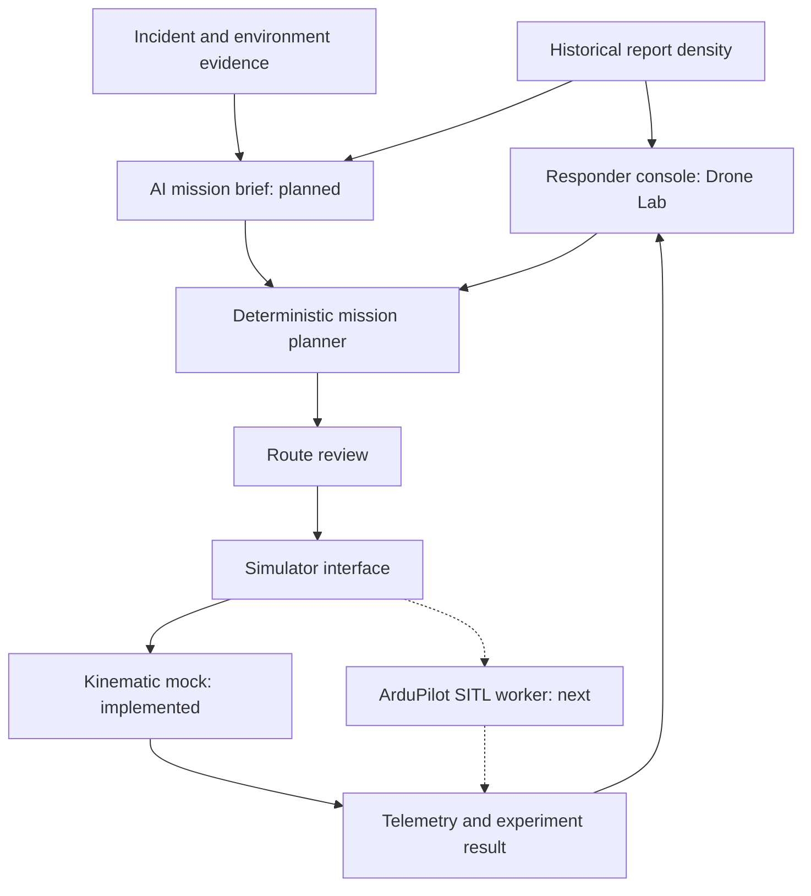

# Drone architecture: local simulation first

The first implementation is a small local vertical slice in the existing
LifeJacket application. Teammates run it after pulling `charlotte` with
`python3 scripts/local_demo.py`; see [the local walkthrough](local_drone_demo.md).
Shared cloud hosting is deferred.

## Boundaries and data flow

The AI suggestion path in this diagram remains an integration target.
Drone Lab now also displays the imported density layer and lets a coordinator
select a thresholded cell as historical context, then manually specify a small
survey and simulated home. The synthetic preset remains available. Historical
context is checked against the current dataset checksum and cell threshold at
both planning and simulation; the chosen survey must fit within that cell.
The AI brief will suggest a bounded survey area, priority rationale,
evidence references and assumptions. It will pass the same typed intent to the
planner. The AI will not change server-owned limits, approve a run, or issue
vehicle commands. Existing `llm/client.py` can supply the model adapter later;
no additional agent framework is needed.

## Code that now exists

| Responsibility | Module | Behavior |
| --- | --- | --- |
| Mission and telemetry contracts | `backend/lifejacket/models/drone.py` | Simulation-only intent, bounded California coordinates, plan, trace and event schemas; unknown controls are rejected |
| Mission planning | `backend/lifejacket/drones/planner.py` | Serpentine area coverage, takeoff/landing, home transit, distance/time estimates, route checks |
| Test assumptions | `config/drone_simulation.json` | Server-owned altitude, wind, range, speed, reserve and sampling assumptions; these are not aircraft specs or legal limits |
| Simulator seam | `backend/lifejacket/drones/simulator.py` | `Simulator` protocol and one registered kinematic mock; no sockets, serial transport or arming code |
| HTTP adapters | `backend/lifejacket/api/routes/drones.py` | Load demo intent, generate a plan, rerun checks and generate a mock trace |
| UI and replay | `DroneLabScreen.tsx`, `DroneLabMap.web.tsx` | Review a synthetic route; replay nominal, low-battery and link-loss scenarios using the existing MapLibre map |
| Portable runtime | `scripts/local_demo.py`, existing staging Dockerfiles | Start frontend, API and local Postgres without cloud credentials; optional private workbook import |

The new routes are stateless. The existing incident and historical-data tables
are reused by their current workflows; simulation does not create incidents,
change assignments, or save mission history. A typed reviewer label is only a
demo acknowledgment, not verified identity or a production authorization gate.

## API contract

| Endpoint | Input | Output |
| --- | --- | --- |
| `GET /drones/demo` | None | Invented home point, survey rectangle and simulated conditions |
| `POST /drones/plan` | `DroneMissionRequest` | Route, estimates, blocked reasons and content-derived `plan_id` |
| `POST /drones/simulate` | Original intent, `plan_id`, review label, mock scenario | Synthetic samples, fault events and result |

Under the local nginx frontend, prefix these paths with `/api`. The simulation
endpoint recomputes the plan and hashes the actual route, estimates, request
and limits. A changed plan or profile requires a fresh review (`409`). Blocked
plans cannot run. Backend choices other than `mock`, device paths, and arbitrary
waypoints are rejected (`422`). There is no hardware connection setting.

Mission checks cover supplied exclusions along **all segments**, including
transit to/from home; checking only waypoint positions would miss a no-fly
rectangle between endpoints. Bounds, altitude, wind, total distance and modeled
battery reserve also gate mock runs. The spherical distance and local straight
segments are appropriate for this bounded demo, not terrain-aware navigation.

## Historical data and AI planning

The first integration reuses the private importer and thresholded density endpoint.
See [the source review and MVP plan](drone_simulation_review.md). A roughly
11-km aggregate cell is an area-level observation summary. It must not become
an animal pin, a drone base, or an automatic mission endpoint. A coordinator
should draw a smaller survey area after considering the coastal geography and
available evidence. Preserve the dataset checksum, cell/context reference and
planning assumptions with a future mission record.

Report density alone is not calibrated stranding probability. A future risk
model needs coastline masks, observation/response effort, temporal features,
held-out evaluation and uncertainty. The initial AI brief should explain these
gaps instead of claiming that a historical hotspot contains an animal now.

## Next: replace mock execution with SITL

ArduPilot SITL runs the actual autopilot code with a flight-dynamics model on a
computer, without an airframe. Its built-in physics is enough for the first
flight-control integration; a separate visual simulator can follow later.

1. Add a local **worker process** that owns one SITL vehicle and its connection.
   Keep long-running flight control outside FastAPI request handlers.
2. Translate the validated plan into MAVLink mission items. Upload mission,
   geofence and safe/rally information as separate plan types where supported;
   require acknowledgments, bounded retries and explicit failure results.
3. Replace the mock result with observed telemetry: vehicle clock, reception
   time, sequence, position, relative altitude, battery and heartbeat freshness.
   Bind commands and events to a mission revision and run ID.
4. Test takeoff, coverage, landing, rejection, low battery, stale telemetry and
   link loss. Measure observed completion and recovery, not just the mocked
   stop event. Compare planned distance/time and remaining battery with SITL.
5. Persist experiments before making the worker asynchronous: `drone_missions`
   (intent, policy snapshot, plan revision, evidence), `drone_runs` (backend,
   status and metrics), and ordered telemetry/events. Use migrations and
   idempotency keys; avoid storing large video blobs in database JSON.

The current `Simulator.run` result is the normalized replay contract. A future
worker needs a job API and incremental events in addition to that result; it
should not hold one HTTP request open for the duration of a flight.

## Later: Pi, imagery and real hardware

Keep the Raspberry Pi as the companion/transport/camera computer, and the
autopilot as the flight controller, as proposed in
[the Pi design](drone_raspberry_pi_design.md). A future Pi adapter can share
validated mission and telemetry contracts with SITL. Physical execution needs
a distinct deployment, authenticated controller identity and operator approval;
it should not become enabled by changing a local demo environment variable.

Captured imagery needs its own provenance: mission/run ID, sensor, capture
time, vehicle position and frame ID. Add a frame-ingestion boundary before
feeding selected images into the current identification/assessment pipeline.
Do not write simulated detections into real incident evidence automatically.

The older proposal's single generic MMPA distance/altitude floor is not a
validated drone flight policy. NOAA currently advises avoiding drone activity
near marine mammals and notes that national UAS guidance is under development.
Real mission constraints must be established with the relevant operators and
authorities for the site, species and activity. The current mock supplies no
wildlife or flight authorization.

Hardware purchase should follow measured SITL results and operator feedback.
The present mock demonstrates the app/planner/replay integration only. Next
UI work is drawing areas and exclusions, linking evidence, and comparing saved
experiments; it does not require a shared cloud deployment.

Primary references:

- [ArduPilot SITL architecture](https://ardupilot.org/dev/docs/sitl-simulator-software-in-the-loop.html)
- [MAVLink mission protocol](https://mavlink.io/en/services/mission.html)
- [NOAA viewing guidance, including drones](https://www.fisheries.noaa.gov/insight/viewing-marine-life)
