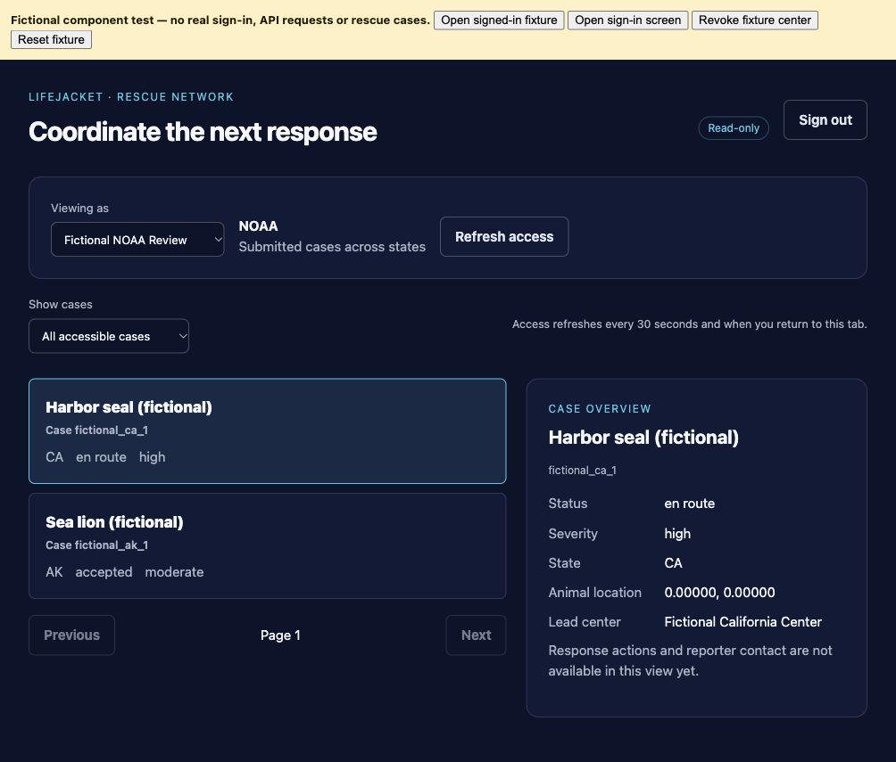

# Verified network web console

The responder console now has a Rescue network tab and a dedicated network-only build. It uses managed Google sign-in and server-approved organization contexts. The current private demo remains in legacy mode; this work has not activated a cloud provider, granted memberships, enrolled real reports or sent notifications.

## User experience

- Sign-in screen: Google sign-in when the web app configuration is present; otherwise a clear unavailable state. A missing configuration does not unlock a demo identity.
- Personal account: receipt case-ID lookup for the caller's own report, minimal status, optional estimated arrival when supplied, and explicit permission to leave without cancelling. No professional membership is created by sign-in.
- Professional context: select only organizations returned by the authenticated session endpoint. Show the backend's role and approved states, then list authorized cases with My center / Assigned to me / Leading / Supporting / Receiving filters. Detail requests recheck access; no legacy full-detail request is used.
- Cases clear on account/context changes and on denied/failed refresh. Pending requests are aborted or their late responses ignored. Access is rechecked every 30 seconds and when returning to the browser tab; displayed data may remain visible until that check. Server authorization still happens on every request.
- Sign-out immediately removes the case view. SDK identity persistence is in memory, so a full page reload requires signing in again. The app does not write ID/refresh tokens or case records to web storage.
- Read-only: no contact, dispatch, location tracking, handoff or rescue-status buttons are wired to legacy mutations. Native app sign-in is not implemented by this slice; the native tab directs users to the web console.

## Configuration

Use the responder console's `.env.example` for these public build-time values:

| Variable | Purpose |
| --- | --- |
| `EXPO_PUBLIC_NETWORK_MODE=true` | Render only the authenticated network console; no legacy navigation/fallback. |
| `EXPO_PUBLIC_API_URL` | HTTPS API origin plus optional proxy prefix; loopback HTTP is allowed for development. No username, password, query string or fragment. |
| `EXPO_PUBLIC_FIREBASE_API_KEY` | Firebase **web app** API key, not an Admin key. |
| `EXPO_PUBLIC_FIREBASE_AUTH_DOMAIN` | Managed sign-in domain. |
| `EXPO_PUBLIC_FIREBASE_PROJECT_ID` | Same managed identity project expected by the backend verifier. |
| `EXPO_PUBLIC_FIREBASE_APP_ID` | Optional registered Firebase web app ID; Identity Platform Auth does not require it. |

The backend must have the intended provider/project configured, `NETWORK_AUTH_ENABLED=true`, reviewed access/case tables and appropriate CORS origins. Enabling backend network mode blocks all legacy routes. Coordinate the client build with this switch; do not enable it on the existing demo service mid-session.

Firebase/provider configuration and authorized domains are external setup steps, not created by npm installation or a build. No service-account credentials belong in `EXPO_PUBLIC_*`. Public web configuration does not grant NOAA or center access; the database membership approval process remains required. See [sign-in setup](network_signin.md) and [case read boundaries](network_case_access.md).

## Token transport and Workbench limitation

The real client sends `Authorization: Bearer <ID token>` and organization selection headers to the configured HTTPS API. The backend's managed cryptographic verifier and membership rules are unchanged. There is no trusted user/role header, anonymous fallback or query-string token. Fetch refuses redirects, obtains a current SDK token on each request and uses same-origin cookies only for an existing gateway. Cross-origin requests do not send gateway cookies. Token lookup and HTTP requests have a 15-second logical deadline; late token lookup results cannot send a cancelled request.

Browser fixture requests through this Workbench notebook proxy arrived without application authentication headers, including a separately tested dedicated token header. Direct loopback requests preserved them. The provider/API endpoint must be configured and verified on a domain that preserves app authentication headers before claiming live sign-in works. The client remains fail-closed through the notebook proxy. No proxy authentication protections were disabled and no weaker auth path was added.

## Verification and isolated preview

Run in `clients/responder_console` with a Node version that supports built-in TypeScript stripping (GCP currently uses Node 25):

```
node --test tests/networkApi.test.mjs
npm run typecheck
EXPO_PUBLIC_NETWORK_MODE=true npx expo export --platform web --output-dir dist-network
```

`tests/networkPreview.tsx` is a separate component-test entry point, never imported by the app. Build it with esbuild, defining `process.env` as `{}` and resolving modules from the console's node_modules; serve its generated index/app.js directory with `python scripts/serve_network_ui_fixture.py --web-dir <fixture directory>`. The server binds only to loopback and serves static files. Fictional identities, cases, organization changes and revocation controls are in the test component's memory. The fixture makes no API/sign-in requests, imports no application database and provides no production auth bypass. Browser component checks verify UI behavior; client transport tests and backend authorization tests verify their respective layers separately. This is not a live managed sign-in or proxy authentication test.

Remaining work: configure and test actual provider sign-in on the intended domain/devices; connect authenticated intake/ownership, reviewed evidence and contact consent; add permitted assignment/coordination and response-event workflows; native sign-in; map view and further case filters. The current UI does not claim these capabilities.

Official SDK references: [Google sign-in](https://firebase.google.com/docs/auth/web/google-signin), [Auth initialization](https://firebase.google.com/docs/reference/js/auth#initializeauth), [persistence](https://firebase.google.com/docs/auth/web/auth-state-persistence).

## Recorded validation

GCP: 10 client request tests; TypeScript check; network-only Expo web export;
Python lint/diff checks; final backend regression suite 537 passed with one
existing Starlette/httpx warning. Browser component checks verified CA versus
AK views, NOAA's broader view, detail, empty filters, personal report status and
unavailable cases, revocation and sign-out clearing during delayed results.
The final production build was opened separately and correctly showed missing
sign-in configuration with no legacy navigation. Live provider/API integration
was not exercised.

The image below is a fictional component fixture, not a live NOAA account or
real rescue reports.



## Live-login readiness check — 2026-11-01 (Chicago)

Confirmed on GCP: network auth is disabled, the backend identity project is unset,
and none of the four Firebase web configuration fields are loaded. The Workbench
service account cannot list project services (serviceusage.services.list denied).
The signed-in Cloud Console can view this project; opening Identity Platform
redirects to its marketplace activation page with Enable Identity Platform.
Activation displays Google Cloud and Firebase Hosting terms. No activation,
provider setup, IAM changes, real sign-in or professional grants were performed.
Approval is pending for activation/configuration; API authentication-header
transport must still be verified before claiming a working live login.

## Identity Platform activation — 2026-11-01 (Chicago)

User approved Identity Platform activation and Google sign-in configuration.
Cloud Console reported successful activation in spring-2026-lifejacket. The
exact existing Workbench preview hostname was added to authorized domains;
no wildcard domains or public rescue-data endpoints were added.

Google provider configuration is still unsaved. Its required web OAuth client
does not exist yet. The prepared OAuth branding form uses LifeJacket, External
testing mode, and the signed-in project owner's support/contact email. Google
requires a separate Google API Services User Data Policy agreement before the
branding/client can be created; that checkbox remains unchecked. The separate
Firebase console also presented additional Firebase terms, which were not
accepted; Cloud Console configuration remains available.

The backend ADC principal was verified as
workbench-sa@spring-2026-lifejacket.iam.gserviceaccount.com. A lookup of a
fictional nonexistent user returned InsufficientPermissionError; the API did
not report insufficient OAuth scopes. The proposed custom role in
[network-token-verifier-role.yaml](../deploy/network-token-verifier-role.yaml)
contains only firebaseauth.users.get. It has NOT been created or bound. This
permission reads managed user records for disabled-account/revocation checks;
it grants no write/delete or LifeJacket professional case role.

Identity Platform supplied its public web API key and authDomain through the
setup dialog. These were not committed. Corrected the frontend to make appId
optional for Auth-only Identity Platform setups. GCP TypeScript and all 10
client request tests passed. No backend auth checks were weakened, real users
created, professional memberships granted or notifications sent. Live Google
sign-in and the API/proxy connection still require end-to-end verification.

Pending approval: Google OAuth User Data Policy and the proposed minimal
backend user-lookup IAM role.

## Google provider configured — 2026-11-01 (Chicago)

With explicit approval for the additional OAuth policy and the minimal backend
permission, accepted the Google API Services User Data Policy and created the
LifeJacket OAuth branding in External / Testing mode. Created the dedicated
LifeJacket Network Web OAuth client using the project-owned Firebase auth
origin and its /__/auth/handler redirect. Google rejected the Workbench hostname
as a direct OAuth JavaScript origin, so it was removed from that OAuth client;
the project-owned Firebase helper remains the OAuth origin. The existing
Identity Platform app-domain allowlist retains the exact preview host.

Configured and saved the Google provider in Identity Platform. The providers
page now shows Google enabled and a successful-update message. Added only the
signed-in project user's UChicago email as an OAuth test user. The OAuth client
secret was transferred directly between Google Console fields, then cleared
from temporary browser variables; it was never placed in source, client config,
terminal output or application logs. Public SDK configuration was prepared on
GCP at ignored var/network-login/web-config.json. The existing private demo
configuration and servers were not switched to active network mode.

The IAM grant was authorized but could not be applied. The Cloud Console
explicitly says the current charlottez account lacks iam.roles.create, and
Grant access is disabled. The IAM table shows Editor (Legacy), Compute Instance
Admin and Notebooks Admin for this account, not project IAM administration.
No custom role was created or bound. Do not replace the approved one-permission
role with a broader predefined role or export service-account keys.

A project IAM administrator must run
[grant-network-token-verifier.sh](../deploy/grant-network-token-verifier.sh)
from the repository. It creates the exact role definition and binds only that
role to workbench-sa. It stops if creation fails or the role already exists so
an existing broader role cannot be silently granted. The approved permission
is firebaseauth.users.get; no case-role or authentication-write grant is included.
The two project Owner principals visible in IAM were kadochnikov@uchicago.edu
and kwaku@uchicago.edu. No messages or access requests were sent.

Shell syntax validation passed for the handoff script. Previously run GCP
TypeScript and 10 client tests passed for the optional-appId change. Managed
Google login through the application has NOT been verified; backend user lookup
remains denied, and the API/header-proxy connection remains a separate check.
No real rescue data, professional memberships or notifications were created.

## Email/password first (2026-11-01)

Email / Password is enabled in Identity Platform alongside Google; passwordless email links remain off. Phone/SMS is deferred. The web screen offers email/password sign-in, account creation, generic password-reset acknowledgement, and an explicit verification-email action. New/unverified accounts stay on a verification screen; checking verification reloads the managed user and forces a new ID token. No workspace mounts until the client sees verified email; the backend remains responsible for independently verifying the token, revocation and approved database membership. Email domains never grant roles.

Passwords go directly to the managed Auth SDK, remain only in transient form state, clear after requests/mode/account changes, and are not written to the application database or logs. Session tokens continue using in-memory persistence. No real account, password or verification/reset email was created/sent during implementation. The fictional email-flow fixture injects a fake driver, is isolated from the app entry point and does not contact Auth or the API.

This provider change does not fix the Workbench service-account `firebaseauth.users.get` permission denial or proxy stripping application authentication headers. Live end-to-end login remains pending those fixes and a user-performed sign-in/email-delivery check. The ignored runtime public web config is prepared but the unconfigured static preview does not constitute live login.

SDK references: https://firebase.google.com/docs/auth/web/password-auth and https://firebase.google.com/docs/auth/web/manage-users .

Validation: GCP TypeScript check, 10 client API tests and Expo web export passed. Browser fictional checks passed for invalid sign-in/password clearing, generic reset acknowledgement on simulated failure, password mismatch, unverified-account gate, verification resend, unverified refresh, verified refresh, and sign-out. No live Auth delivery or end-to-end API login is claimed.
