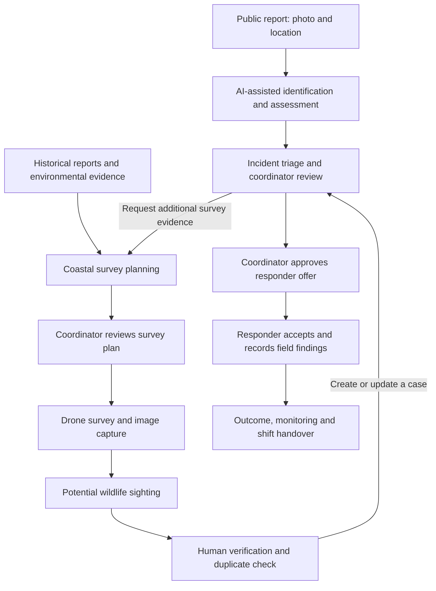

# LifeJacket: Unified Monitoring and Rescue Workflow

**Project:** Integrating AI-Assisted Drone Surveillance and Rescue Coordination
for Coastal Wildlife

**Goal:** Connect public wildlife reports, coastal surveillance and rescue
organizations through one system for reviewing evidence and coordinating a
response. Initial development focuses on California marine mammals.

## Overall workflow

This diagram describes the intended integrated system. It includes planned
connections; the status table below distinguishes them from working features.

## Two entry paths, one coordination workflow

### 1. Public reporting and incident follow-up

1. A person submits an animal photo and location through the app.
2. LifeJacket detects the target animal, supports identification, asks clarifying
   questions and assesses its condition using available environmental context.
3. Deterministic rules calculate severity. The system prepares a checked report,
   flags possible duplicates and suggests responder organizations.
4. A coordinator reviews the evidence. In the proposed drone extension, the
   coordinator can also request a survey when additional observations would help.
5. The coordinator approves an assignment offer. A responder accepts or declines,
   and field findings, case outcomes and handover information are recorded.

### 2. Coastal surveillance and drone-originated sightings

1. Historical stranding report density helps identify areas worth reviewing.
   Seasonal and environmental risk analysis will be added and evaluated later.
2. A coordinator chooses a small survey area and a suitable home location.
   The planner produces waypoints and checks configured constraints.
3. The coordinator reviews the route. Physical flights will additionally require
   operator authorization and appropriate site, airspace and wildlife constraints.
4. The intended drone workflow captures imagery, timestamps and vehicle position.
   A detector flags potential sightings for human review; vehicle position must
   remain distinct from an estimated animal location.
5. A reviewer rejects false alerts, links duplicate sightings or creates a case.
   Verified cases enter the same assessment and coordination workflow as public
   reports. Incomplete evidence stays flagged for review.

**Human decision boundary:** AI supports detection, assessment and prioritization.
It does not independently authorize physical surveys or dispatch rescuers.

## Current progress

Status reflects the reviewed repository and the local development branch
`charlotte-drone-historical-context`; the local changes have not been pushed.

| Component | Current status |
| --- | --- |
| Public reporting, identification, assessment and deterministic triage | Implemented; model accuracy remains a separate evaluation task |
| Coordinator review, responder offers/responses, logs and handover | Implemented prototype; authenticated roles and operational permissions remain incomplete |
| NOAA historical import and report-density map | Implemented; report density is not calibrated stranding probability |
| Survey waypoints, route checks, review acknowledgment and mock flight replay | Implemented; not flight-dynamics or hardware validation |
| Historical cell selection connected to survey planning | Implemented on the local feature branch; requires an authorized local NOAA import |
| Seasonal/environmental risk prediction | Planned |
| Drone imagery ingestion, aerial detector and sighting review queue | Planned |
| Incident-linked survey request and verified sighting-to-case handoff | Planned |
| ArduPilot SITL integration, Pi companion and physical drone operation | Planned |

## Immediate development milestone

Demonstrate one complete application workflow:

**Historical NOAA density → selected survey area → reviewed waypoint plan →
mock patrol → explicitly synthetic sighting → coordinator verification.**

Historical-context planning and mock replay are connected on the local feature
branch. Synthetic sightings and their review/handoff are the next missing link.
Test evidence must remain separate from real observations and active incidents.

Then validate autopilot execution with ArduPilot SITL. A single borrowed or
purchased development drone would follow successful software checks, a defined
test protocol and a useful partner-supported use case. Expanding to a network
depends on the results of that pilot.

## Supporting documents

- [Existing rescue workflows](rescue_workflows.md)
- [Drone architecture and API contracts](drone_architecture.md)
- [Source review, gaps and development plan](drone_simulation_review.md)
- [Local setup and walkthrough](local_drone_demo.md)
- [Raspberry Pi companion proposal](drone_raspberry_pi_design.md)
